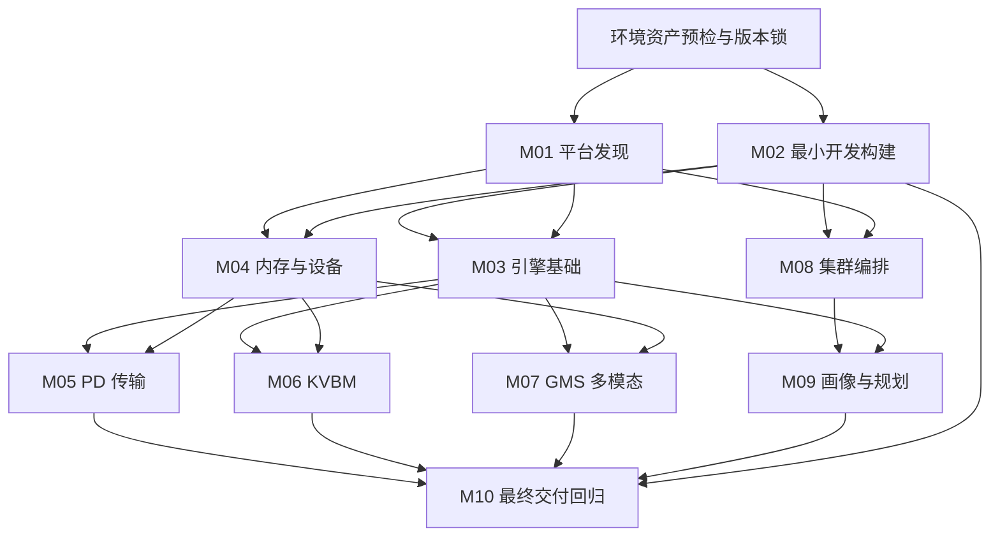

<!--
SPDX-FileCopyrightText: Copyright (c) 2026 HEYI. All rights reserved.
SPDX-License-Identifier: Apache-2.0
-->

# 自动适配工作流设计

目标是让新芯片复用完整 M01–M10 方法，而不是复制某个平台的聊天过程。契约与证据是事实来源，AI 是可更换的实施和诊断执行者。

## 分层与事实来源

环境清单描述节点、SSH alias、设备、模型、镜像、集群及预算；不保存凭据。平台清单只引用 container/platforms 的构建锁，避免两份版本表。feature.yaml 定义稳定功能编号、revision、依赖、前置条件和可观察的验收断言。campaign 固定这些输入和实际源码指纹；每次 attempt 追加执行和清理记录。报告从这些记录生成。

运行时支持能力与认证状态分开：native supported 参数原样透传，不因未测试某个 TP 组合阻止启动。认证只覆盖实际型号、版本、模型、拓扑和用例。没有环境属于 pending/blocked；暂缓需要注明原因；不适用与官方明确不支持均需依据。

## 模块依赖

该图是概览，实际以功能依赖闭包为准。M05 用于传输语义，M08 用于编排部署；M08 DGDR 验证任务编排，M09 验证采样/插值/画像复用及在线决策。M02 负责构建，M10 复用构建结果并认证最终镜像，不复制实现。

## 状态与门禁

implementation、task、test、qualification、evidence origin、freshness 各自独立。AI 完成实现不能推出测试通过；测试脚本退出码零不能推出行为正确；旧证据不能推出新版本通过；小模型功能通过不能推出生产 SLA 达标。API 正确性、KV 字节、token 一致、取消恢复、规划连续性和 SLA 需要分别断言。

每次失败保留原因和原始输出。原生引擎问题必须有可比对照，且仍应记录本次端到端结果；环境故障不触发盲目修改产品代码。新版本使旧证据 stale，不能修改旧 attempt 适配新身份。资源锁防止并发占用，运行中断必须 reconcile，不能因为本地进程消失而自动重启远端任务。

## 当前实现边界

V1 为轻量 Python CLI、文件状态和 JSONL 事件，不要求数据库服务。默认串行执行；按节点加锁。无 cluster 的平台可以做代码、静态和单机任务，集群功能保持待验证。范围声明、any-of 依赖、相关输入/下游失效、严格等价证据继承及有界 AI 实施循环已经接入。独立 case 配方经 compile 冻结，运行和 AI 会话的状态均保存在 results。真实 AI 账号测试按用户决定暂缓。默认单代理执行，多代理并发不作为当前定版要求。新芯片仍需要实现硬件 provider、选择真实模型及编写独立验证器，不能凭目录生成器自动宣称适配成功。

旧结果按平台/功能重新组织，未知芯片使用 unspecified；迁移说明区分原始摘要和规范化摘要。既有工程架构背景见 [architecture-reference.md](architecture-reference.md)，其中历史进度不能替代现行契约。

完整方案对照与定版验收边界见 [定版审计](workflow/finalization.md)，不能用目录迁移完成替代自动工作流完成。
