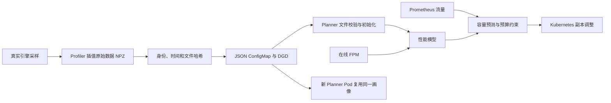

<!--
SPDX-FileCopyrightText: Copyright (c) 2026 HEYI. All rights reserved.
SPDX-License-Identifier: Apache-2.0
-->

# M09 离线画像到在线 Planner

本补充验收验证用户要求的链路：真实引擎采样 → 插值数据落盘 → Profiler 生成 ConfigMap/DGD → Planner 从文件初始化性能模型 → 在线决策 → Planner 重启复用。先前的候选测量和实时 FPM 回归不能替代这个闭环。



文件模式固定的是**初始化数据来源**，不是冻结整个在线模型。真实负载期间仍需检查性能模型是否可用；只看到文件加载日志或副本保持不变，不能证明在线规划正常。

## 实现与验收边界

- `offline_profile.py` 调用生产代码 `run_interpolation`、`write_profile_manifest`、`assemble_final_config`。本轮固定已选 TP：小模型 TP1、Qwen3-32B TP4、DeepSeek CUDA TP4 / Ascend TP8 EP；搜索候选的测试此前单独完成。本补充不宣称这些配置是搜索所得最优配置。
- prefill 保存 ISL/TTFT；decode 保存 KV 使用量、上下文长度、ITL 和显式活跃序列上限，原始数据为 NPZ。组装部署时转换为 JSON ConfigMap，重新计算 JSON 文件哈希，同时保留测量时间与画像身份。
- 新增 `pre_deployment_metrics_source: files`，要求明确的 `profile_identity` 和数据目录。缺失、过期、身份不一致、内容哈希变化或非法数值均报错，不悄悄改用实时 endpoint/AIC。默认 `auto` 保留旧有优先级。
- 标准 `run_profile` 入口接受 `features.planner.profile_identity` 或 `DYN_PROFILE_IDENTITY` 文件；同时提供时必须一致。文件模式显式要求插值采样，不被默认 rapid sweep 设置跳过。聚合 pick 当前没有这条离线 PD 数据生成路径，文件模式会明确报错；默认聚合实时路径不变。文件模式不自动附加 AIC 数据库配置；用户显式提供的预测模型配置仍须自行确认来源。
- 当前文件样本没有 attention-DP rank 分组，因此文件初始化模式明确要求 DP1；标准 Profiler 入口在选出 DP>1 配置后、插值测量前报错，加载器也拒绝该画像。原有自动初始化路径保留，本轮没有认证 grouped-DP 离线画像。
- `check_offline_profile.py` 在无实时 worker 接口的情况下加载画像、构造真实 `PlannerEnginePerfModel`，两次计算同一输入的容量。核对完整采样网格，比较容差为相对/绝对 `1e-9`。这验证复用的确定性，不验证预测精度。
- 在线仅开启 throughput scaling，关闭独立 load scaling，使验收中的扩缩容由带离线初始化的性能模型驱动。之后仍可吸收实时 FPM，不代表整个运行期间只用静态文件。
- `check_online_planning.py` 核对正式负载时间窗：必须有同一轮、非零流量下的 P/D 容量预测及 `throughput_reason=scale`。只有 Pod Ready、API 成功或缺指标时的 HOLD 不算在线规划通过；校准阶段的预测也不替代负载阶段。
- `restart_offline.py` 删除本次 Planner Pod，检查新 UID 和两角色的样本数、画像指纹一致。另执行重启后的 API 请求。

小模型预算 4 卡，验证 decode 自动扩容及恢复到 1P1D；大模型预算为恰好 1P1D，验证加载、预测、预算约束、服务与重启，不能把 HOLD 称为再次证明大模型扩容。此前的聚合部署动态扩容证据仍独立保留。

## 复现

先按 [基础复现说明](reproduce.md) 准备 Operator、平台工具镜像、独立 Python 依赖和 Prometheus。源码目录必须同步到实际 worker 节点；CUDA 使用各节点已有模型 hostPath，不要求共享存储。

```bash
platform=cuda
workdir=/home/bedicloud/CJ_workspace/m09-offline-1030
python3 adapter/m09/render_offline.py --platform "$platform" \
  --workdir "$workdir" --output /tmp/offline
python3 adapter/m09/package.py --output /tmp/offline-source.tar.gz
# 将源码解压到目标节点 $workdir/source；复制 input.json、tools.json、rbac.json。
# $workdir/deps 指向同平台的 Planner 依赖目录。
kubectl apply -f rbac.json
kubectl apply -f tools.json
kubectl -n dynamo-m08-1029 exec m09-offline-tools -- \
  /opt/dynamo/venv/bin/python /offline/source/adapter/m09/offline_profile.py \
  --input /offline/input.json --output /offline/profile
```

采样 decode worker 存活时保存其 `DynamoWorkerMetadata` 为 `sweep-mdc.json`，过滤到本次 deployment，确保只含一个 engine 的 `runtime_config`。两角色设备/容量不同时，另存 `prefill-sweep-mdc.json`。保留 Pod YAML、节点、镜像 ID 和实际软件版本。

把 `finish_offline.sh`、`check_offline_profile.py`、`prepare_offline_online.py`、`campaign.py`、`load.py`、`restart_offline.py` 复制到工作目录。然后在控制节点运行：

```bash
# 这里只是示例命令；并发须按平台校准，不直接套用 CUDA 突发到 Ascend。
M09_SOURCE_DIR=source bash finish_offline.sh "$workdir" profile \
  m09-offline m09-offline-tools 16 2 source
python3 collect_offline.py --workdir "$workdir" --profile profile
# 完成证据采集和 API 复测后，只删除本次 DGD；保留 M08 Operator。
kubectl -n dynamo-m08-1029 delete dgd m09-offline
```

大模型通过 `render_offline_large.py` 生成独立工作目录和工具 Pod。工具内存上限 32 GiB；CUDA DeepSeek 曾在 8 GiB 下发生工具 Pod OOM，推理 worker 未同时退出。恢复采样可用 `offline_profile.py --resume-decode-url ... --resume-max-kv-tokens ...`：只复用已完成的 prefill 原始数据，必须保存仍运行的 decode 配置/MDC，全部 decode 点重新测量。失败目录保留，恢复写入新目录。

## 已识别的问题与处理

- 当前 v1beta1 的 `scalingAdapter` 是空对象标记，不能生成不存在的 `enabled` 字段；已按实际 API 修正。
- Prometheus 抓取需保留 worker 的 `dynamo_namespace` 标签，避免 Planner 读取到零流量；对齐 Helm 的标签映射和 `honorLabels`。
- CUDA 测试 Prometheus 原本设置两小时运行期限，在 DeepSeek 校准期间到期；已保存前后 Pod 与恢复日志，重建为六小时期限并确认恢复实际流量规划。
- CUDA Qwen32 首轮 C16 正式负载期间没有有效 decode 容量规划，尽管 API 无错误；保留该轮失败审计。C2 补测完成加载/复用与部分负载规划，但仍有 17 次拟合不可用，单列为有局限的功能结果；日志重建得到两个零斜率的常数拟合，触发 AISimulate 0.12.0 已有的保护规则；保留该原生规则，尚未认证持续稳定规划。源码依据见 [上游回归实现](https://github.com/ai-dynamo/aisimulate/blob/1f728534910187ecb2f021ef5e4bd4949bd555d0/crates/core/src/perfmodel/fpm/regression.rs#L185) 及结果中的 `readiness-rule.json`。
- 大模型复制聚合引擎参数时遗漏 decode-local canary。已恢复基线的 `x-bypass-remote-prefill` 探针；正式请求仍检查 PD 契约，未通过删除契约校验解决。
- TP4/TP8 曾被两处历史 TP1/2 门控提前拒绝。现已删除等宽和异宽 TP 的已测组合白名单，正整数 TP 交给原生引擎及 connector 校验分片比例与布局；保留当前 DP1、文本 eager 和 connector/模型/layout 契约。华为显式开启 `heyi_tp_split` 时仍仅允许 P1→D2，因为该补丁确实使用两路地址切分及 ACK；不开启时不以 TP 组合提前拒绝。量化/EP 参数不再统一禁止。具体变更与测试见 [TP 参数透传](tp-delegation.md)。
- decode 插值并发原先仅按 KV 容量推导，可能超过 `max-num-seqs`。vLLM 显式配置该值时现按每引擎上限乘 DP 限幅，并记录进 NPZ；没有显式值时保留原行为，不猜测版本默认值。验收脚本另外比对实际 MDC 的活跃序列上限。DeepSeek 旧的未限幅采样不纳入最终画像。
- Ascend DeepSeek 工具镜像的 Transformers 5.5.4 通过 AutoTokenizer 加载模型配置失败。独立工具 ConfigMap 对本地明确声明 `PreTrainedTokenizerFast` 的目录直接使用对应类；未知类/远端名称保持原 loader。模型权重、tokenizer 文件、推理引擎版本和共享 M08 ConfigMap 未改动；英文、中文、代码及特殊 token 的 ID 与原始 tokenizer.json 比较一致。生成脚本为 `patch-aiperf-local-fast.py`。
- Ascend DeepSeek 的 AIPerf 可选 GPU telemetry 子服务曾超时退出，测量继续；请求计数、错误和时延来自请求测量。不能据此声称 AIPerf 已支持 Ascend 设备遥测；平台 exporter 的只读遥测另行验收。
- Ascend 小模型第一次 C64 突发有 Mooncake 超时和 prefill 重启，保留失败；重测使用 C16、120 秒健康请求等待及 180 秒优雅退出。这不提高 KV 传输协议自身的超时上限，也不证明无限负载可用。
- Ascend DeepSeek 首轮 prefill 每点只有 1 个正式请求，六点 TTFT 为 433–490 ms，未呈现可用于原生非负拟合的增长信号；文件读取和 decode 预测通过，prefill 预测为空，因此该轮不能算闭环通过。`repeat_prefill.py` 固定每点并发 1、8 次预热及 16 次正式请求完整重测六点，保留原失败画像及未经改写的 decode 数据；不挑选单个有利点，不修改拟合保护规则。重复采样仍无法生成 prefill 容量模型，因而该平台/模型的在线闭环未通过；无 TTFT 约束时同样失败。完整结果见离线验收记录。
- Ascend Qwen32 的离线模型在验收输入下预测 ITL 约 199 ms，原先沿用的 150 ms 目标无可行容量。在线负载开始前，将功能测试目标校准为 300 ms，保存原配置、原预测与 `sla-calibration.json`；画像本身未重写。这是基于实测基线选择测试目标，不是证明生产 SLA 达标。

## 证据口径

`results/offline/<platform-model>/` 保留画像、配置、执行审计、离线复用结果、在线副本记录及重启记录。完整原始 AIPerf 请求和 worker 日志归档在目标工作目录，仓库保留归档位置、大小和 SHA256。`collect_offline.py` 分别按 profiling/warmup 阶段核对预期与完成数，不把 warmup 的 3 个请求误当成 profiling 的请求数量。

画像身份来自显式环境取证，不自动证明宿主机从未变化。模型配置 SHA256 不等于全部权重哈希；插值覆盖范围、decode 队列压力、稀疏采样及预测误差需独立评估。功能测试和预设延迟目标不是生产 SLA 认证；DeepSeek 的 token-ID 时延与可见文本时延须分开报告。MetaX 无集群，保持未认证。
